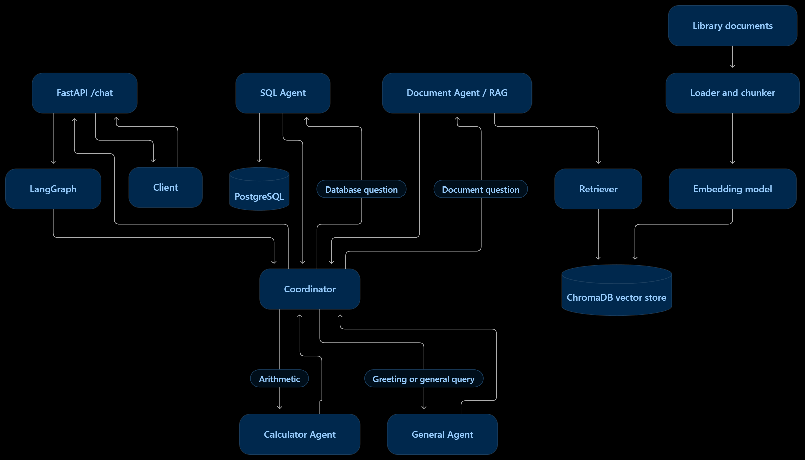

# Smart Library AI Assistant

An AI-powered library assistant built with **FastAPI, LangGraph, PostgreSQL, ChromaDB, and Google Gemini**. The system uses specialized agents to answer questions about library data and documents, perform calculations, and handle general queries.

## Features

- **NL2SQL Agent:** Answers questions about library members, books, and loans using PostgreSQL.
- **Document RAG Agent:** Retrieves relevant information from library documents using ChromaDB.
- **Calculator Agent:** Performs arithmetic operations and supports multi-step calculations.
- **Coordinator Agent:** Routes user questions to the appropriate agent using LangGraph.
- **General Agent:** Handles greetings and general queries outside specialized workflows.
- **FastAPI:** Provides an HTTP API for interacting with the assistant.

## Architecture


<p align="center">
  
</p>


## Requirements

- Python 3.10+
- Docker and Docker Compose
- Google Gemini API key
- Git

## Setup and Run

### 1. Clone the Repository

```powershell
git clone <YOUR_GITHUB_REPOSITORY_URL>
cd smart-library
```

### 2. Create a Virtual Environment

```powershell
python -m venv .venv
.\.venv\Scripts\Activate.ps1
pip install -r requirements.txt
```

### 3. Configure Environment Variables

Create a `.env` file based on `.env.example` and configure the required environment variables, including:

- Google Gemini API key
- PostgreSQL connection URL
- Any additional settings required by the application

Use the variable names and formats defined in `.env.example`.

**Never commit `.env` or API keys to GitHub.**

### 4. Start PostgreSQL with Docker

Start the PostgreSQL service:

```powershell
docker compose up -d
```

Check the container status:

```powershell
docker compose ps
```

Ensure the database connection URL in `.env` matches the PostgreSQL configuration in the Compose file.

Initialize the database schema and sample data using the project's configured initialization procedure before running database-related scenarios.

### 5. Index the Documents

Place the source documents in the configured documents directory, then run:

```powershell
python index_documents.py
```

The indexing script loads the documents, splits them into chunks, generates embeddings, and stores them in ChromaDB.

Run this step before testing document-question-answering scenarios. Re-run the script whenever the indexed documents need to be added or updated.

### 6. Start the API

```powershell
uvicorn app.main:app --reload
```

The API will be available at:

`http://127.0.0.1:8000`

Interactive API documentation:

`http://127.0.0.1:8000/docs`

## API Usage

Send a `POST` request to `/chat` with a JSON body.

**Example request:**

```json
{
  "question": "نام اعضایی که حداقل یک امانت معوق دارند چیست؟"
}
```

**Example using PowerShell:**

```powershell
$body = @{
    question = "نام اعضایی که حداقل یک امانت معوق دارند چیست؟"
} | ConvertTo-Json

Invoke-RestMethod `
    -Uri "http://127.0.0.1:8000/chat" `
    -Method Post `
    -ContentType "application/json" `
    -Body $body
```

The response contains the assistant's answer and may include additional information such as retrieved sources, generated SQL, or query results, depending on the executed workflow.

## Integration Tests and Scenarios

The integration-test scenarios are defined in `test_integerated.py`. They cover the project's main workflows, including document retrieval, NL2SQL, calculations, and other supported scenarios.

Run the tests with:

```powershell
pytest -v test_integerated.py
```

If the file is designed to run as a standalone script, use:

```powershell
python test_integerated.py
```

**Test results are saved in `scenario_results.json`.**

Before running the scenarios, ensure that:

- PostgreSQL is running and initialized.
- The `.env` file contains valid configuration.
- The ChromaDB document index has been created.
- The Google Gemini API key is valid and the API quota is sufficient.

## Technology Stack

| Component | Technology |
|---|---|
| API | FastAPI |
| Agent orchestration | LangGraph |
| Language model | Google Gemini |
| Structured database | PostgreSQL |
| Document vector store | ChromaDB |
| Language | Python |

## Notes

- PostgreSQL stores structured library data, while ChromaDB stores document embeddings.
- The document index must be initialized before document-based queries can be answered.
- LLM requests depend on external API availability and quota.
- Keep credentials and other secrets out of version control.